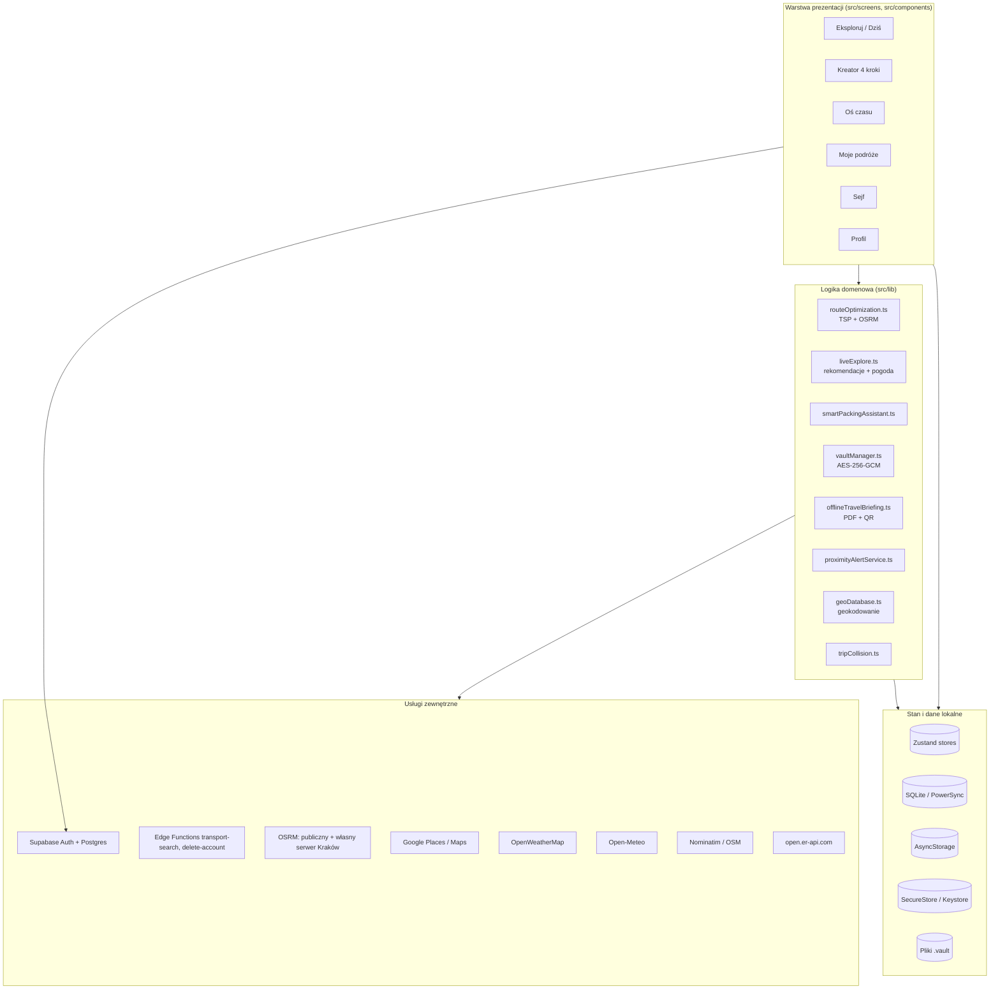

# Destivo

**Mobilny asystent podróży, który prowadzi użytkownika od pomysłu na wyjazd, przez zaplanowanie trasy, aż po moment okazania biletu na peronie.**

Destivo to aplikacja na Androida (React Native + Expo), która łączy w jednym miejscu rzeczy rozrzucone zwykle po kilku aplikacjach: inspiracje wyjazdowe dopasowane do prognozy pogody, kreator podróży, plan dnia na osi czasu, optymalizację kolejności zwiedzania (problem komiwojażera), zaszyfrowany sejf na bilety i dokumenty, listę pakowania zależną od pogody, dokument PDF do użytku bez internetu i powiadomienia przed odjazdem.

Projekt powstał jako praca inżynierska. Jego rdzeniem algorytmicznym jest moduł optymalizacji trasy, który porównuje cztery metody rozwiązywania problemu komiwojażera na rzeczywistej sieci drogowej (OSRM).

---

## Spis treści

1. [Najważniejsze cechy w skrócie](#1-najważniejsze-cechy-w-skrócie)
2. [Stos technologiczny](#2-stos-technologiczny)
3. [Architektura](#3-architektura)
4. [Funkcje aplikacji: szczegółowy opis](#4-funkcje-aplikacji-szczegółowy-opis)
   - 4.1 [Konto, logowanie i tryb gościa](#41-konto-logowanie-i-tryb-gościa)
   - 4.2 [Eksploruj: rekomendacje wyjazdów na podstawie pogody](#42-eksploruj-rekomendacje-wyjazdów-na-podstawie-pogody)
   - 4.3 [Szczegóły destynacji i szybki kreator](#43-szczegóły-destynacji-i-szybki-kreator)
   - 4.4 [Kreator podróży (4 kroki)](#44-kreator-podróży-4-kroki)
   - 4.5 [Wykrywanie kolizji terminów](#45-wykrywanie-kolizji-terminów)
   - 4.6 [Ekran aktywnej podróży („Dziś”)](#46-ekran-aktywnej-podróży-dziś)
   - 4.7 [Oś czasu podróży](#47-oś-czasu-podróży)
   - 4.8 [Inteligentna optymalizacja trasy (TSP)](#48-inteligentna-optymalizacja-trasy-tsp)
   - 4.9 [Moje podróże i statystyki](#49-moje-podróże-i-statystyki)
   - 4.10 [Dynamiczny asystent pakowania](#410-dynamiczny-asystent-pakowania)
   - 4.11 [Sejf: szyfrowane bilety i dokumenty](#411-sejf-szyfrowane-bilety-i-dokumenty)
   - 4.12 [„Bilet w zasięgu ręki”: szybki podgląd biletu](#412-bilet-w-zasięgu-ręki-szybki-podgląd-biletu)
   - 4.13 [Offline Travel Briefing (PDF)](#413-offline-travel-briefing-pdf)
   - 4.14 [Alerty bliskości, powiadomienia i geofencing w tle](#414-alerty-bliskości-powiadomienia-i-geofencing-w-tle)
   - 4.15 [Kalkulator walut i numery alarmowe](#415-kalkulator-walut-i-numery-alarmowe)
   - 4.16 [Dwujęzyczność (PL / EN)](#416-dwujęzyczność-pl--en)
   - 4.17 [Profil, prywatność i usuwanie konta](#417-profil-prywatność-i-usuwanie-konta)
5. [Dane, zapis i synchronizacja](#5-dane-zapis-i-synchronizacja)
6. [Usługi zewnętrzne](#6-usługi-zewnętrzne)
7. [Bezpieczeństwo](#7-bezpieczeństwo)
8. [Testy](#8-testy)
9. [Uruchomienie projektu](#9-uruchomienie-projektu)
10. [Struktura katalogów](#10-struktura-katalogów)
11. [Znane ograniczenia](#11-znane-ograniczenia)

---

## 1. Najważniejsze cechy w skrócie

| Obszar | Co dostaje użytkownik |
|---|---|
| **Inspiracja** | 16 propozycji wyjazdów wybranych z puli ponad 60 miejsc na podstawie położenia użytkownika i 5-dniowej prognozy pogody, z najlepszym terminem w oknie prognozy |
| **Planowanie** | Kreator w 4 krokach: cel, transport, nocleg, atrakcje na mapie z Google Places |
| **Plan dnia** | Oś czasu z podziałem na dni, edycją, przesuwaniem punktów i propozycjami atrakcji |
| **Algorytmy** | Optymalizacja kolejności zwiedzania: zachłanny, 2-opt, relokacja, symulowane wyżarzanie i metoda dokładna, na macierzy czasów przejazdu z OSRM |
| **Bezpieczeństwo** | Pliki szyfrowane AES-256-GCM, klucz w Android Keystore, PIN przechowywany jako solony skrót z limitem prób, biometria |
| **W podróży** | Szybki podgląd biletu z maksymalną jasnością ekranu i kodem QR odczytanym z biletu, alert w pobliżu dworca lub lotniska (także przy zamkniętej aplikacji), powiadomienie przed odjazdem |
| **Bez internetu** | PDF z planem dnia, transportem, biletami, adresem noclegu, kursem waluty (z datą kursu) i numerami alarmowymi |
| **Jakość** | 48 zestawów, 611 testów automatycznych (jednostkowe, komponentowe i scenariusze E2E), TypeScript bez błędów, benchmark algorytmów do pracy (`npm run benchmark`) |

---

## 2. Stos technologiczny

| Warstwa | Technologia |
|---|---|
| Framework mobilny | React Native 0.81, React 19.1, **Expo SDK 54** (dev client, build natywny) |
| Język | TypeScript 5.9 |
| Nawigacja | React Navigation 7 (dolne zakładki + stosy) |
| Stan aplikacji | Zustand 5 (z `persist` do AsyncStorage) |
| Lokalna baza danych | SQLite przez SDK PowerSync (`@powersync/react-native`) |
| Backend / konta | Supabase (Auth + Postgres) oraz dwie Supabase Edge Functions (Deno): `transport-search`, `delete-account` |
| Mapy | `react-native-maps` (Google Maps SDK for Android) |
| Kryptografia | `@noble/ciphers` (AES-256-GCM), `expo-crypto`, `expo-secure-store` |
| Kody QR | `jsqr` (odczyt), `qrcode` (generowanie), `jpeg-js`, `upng-js`, `pako` (dekodowanie obrazów i strumieni PDF) |
| Funkcje urządzenia | `expo-location`, `expo-task-manager`, `expo-notifications`, `expo-local-authentication`, `expo-brightness`, `expo-print`, `expo-sharing`, `expo-document-picker`, `expo-image-picker`, `expo-image-manipulator` |
| Stylowanie | NativeWind / Tailwind oraz `StyleSheet` |
| Testy | Jest 29 + `jest-expo` + React Native Testing Library |

---

## 3. Architektura



**Kluczowe decyzje architektoniczne:**

- **Najpierw lokalnie (offline-first).** Każda podróż zapisywana jest najpierw w lokalnej bazie SQLite i w kopii w AsyncStorage, a dopiero potem w chmurze Supabase. Aplikacja działa w trybie gościa całkowicie bez konta.
- **Logika oddzielona od widoków.** Algorytmy, kryptografia, generowanie PDF i reguły pakowania znajdują się w `src/lib` jako czyste funkcje TypeScript. Dzięki temu są testowane jednostkowo niezależnie od interfejsu.
- **Klucze API poza kodem.** Wszystkie klucze pochodzą z `.env` (lokalnie) lub ze zmiennych środowiskowych EAS (buildy w chmurze).

---

## 4. Funkcje aplikacji: szczegółowy opis

### 4.1 Konto, logowanie i tryb gościa

**Co robi.** Ekran powitalny pozwala założyć konto, zalogować się albo wejść jako gość. Zalogowany użytkownik ma podróże zapisywane w chmurze. Gość może zaplanować jedną podróż, a dane trzyma tylko na telefonie.

**Jak działa.**
- Rejestracja i logowanie: Supabase Auth (e-mail + hasło). Sesja jest przechowywana w AsyncStorage i odświeżana automatycznie.
- **Reset hasła przez deep link:** Supabase wysyła e-mail z linkiem `destivo://reset-password`. Aplikacja przechwytuje go (`Linking`) i otwiera formularz ustawienia nowego hasła, nawet gdy użytkownik jest już zalogowany.
- Tryb gościa: limit jednej podróży sprawdzany zapytaniem do lokalnej bazy przed utworzeniem kolejnej. Komunikat proponuje usunięcie starej podróży albo założenie konta.

**Dlaczego to fajne.** Można wypróbować całą aplikację bez rejestracji, a zarejestrowany użytkownik nie traci danych po zmianie telefonu.

---

### 4.2 Eksploruj: rekomendacje wyjazdów na podstawie pogody

**Co robi.** Zakładka „Eksploruj” (gdy użytkownik nie ma trwającej podróży) pokazuje karty z propozycjami wyjazdów. Każda karta ma zdjęcie miasta, odległość, rekomendowany środek transportu, proponowany termin i przewidywaną temperaturę. Filtry pozwalają zawęzić listę: loty, wypady autem, jednodniówki, miejsca mniej oczywiste („off the beaten path”).

**Jak działa** (`src/lib/liveExplore.ts`):
1. Pobiera położenie użytkownika (`expo-location`) i wyznacza najbliższe polskie lotnisko (WAW, KRK, GDN, KTW, WRO, POZ i inne).
2. Dla każdego miejsca z puli (europejskie stolice, polskie miasta, ukryte perełki, jednodniówki) liczy odległość wzorem haversine'a i dobiera transport: samolot dla dalekich tras, pociąg dla średnich, samochód dla bliskich i jednodniówek. Pomija miejsce, w którym użytkownik już jest (mniej niż 20 km).
3. Równolegle (z limitem czasu) pobiera **5-dniową prognozę OpenWeatherMap** i szuka w niej najlepszego okna o długości dopasowanej do transportu (np. 3–4 dni dla lotu, 1 dzień dla jednodniówki). Za idealne okno uznaje dni bez opadów.
4. Sortuje miejsca według pogody (brak opadów + temperatura) i dobiera zróżnicowaną listę 16 propozycji z różnych kategorii. Dni bez pomiarów w oknie prognozy są pomijane przy liczeniu średniej, zamiast podstawiać stałą wartość.
5. **Bez prognozy** (brak sieci lub API nie odpowiada) karty pokazują miejsce, odległość, transport i termin, ale **bez temperatury**, z etykietą „Brak aktualnej prognozy”. Lista jest wtedy sortowana według odległości.
6. Dla miast z gotowym planem buduje wstępny plan dnia z listy atrakcji, uporządkowany geograficznie.
7. Zdjęcia miast pobiera **wyłącznie na żywo z Google Places** (wyszukiwanie miejsca + zdjęcie). W kodzie nie ma żadnych zdjęć wpisanych na sztywno, a pilnuje tego osobny test. Pamięć podręczna przechowuje samo odwołanie do zdjęcia (7 dni, brak zdjęcia: 1 dzień), a adres budowany jest przy odczycie, więc zmiana klucza API nie psuje zapamiętanych zdjęć. Gdy Google nie ma zdjęcia, karta pokazuje neutralny placeholder.
8. Informacja o tłumie jest pokazywana tylko wtedy, gdy udało się ją wyliczyć z liczby opinii w Google Places.

**Dlaczego to fajne.** Zamiast pytać „gdzie chcesz jechać?”, aplikacja sama podpowiada, gdzie w najbliższych dniach będzie ładnie i jak tam dojechać z miejsca, w którym jesteś.

---

### 4.3 Szczegóły destynacji i szybki kreator

**Co robi.** Po wybraniu karty widać opis miejsca, prognozę na proponowany termin (albo etykietę „Brak aktualnej prognozy dla tego terminu”), rekomendowany transport i, jeśli istnieje, gotowy plan zwiedzania z podziałem na dni. Przyciski otwierają:
- **Skyscanner** z wypełnioną trasą (kod najbliższego lotniska → kod lotniska docelowego), **Koleo** dla pociągu lub **Google Maps** z nawigacją dla samochodu,
- **Booking.com** z wyszukiwaniem noclegów w danym mieście,
- **Google Maps** z wyszukiwaniem restauracji w okolicy.

**Szybki kreator** (`QuickSetupScreen`) tworzy kompletną podróż jednym ekranem: użytkownik potwierdza daty, a aplikacja generuje oś czasu z wyjazdem, zameldowaniem, atrakcjami rozłożonymi na dni, noclegami między dniami i powrotem. Przed zapisem sprawdza kolizję terminów (punkt 4.5).

**Dlaczego to fajne.** Od inspiracji do gotowego planu wystarczą dwa kliknięcia. Rezerwacje pozostają w sprawdzonych serwisach, do których aplikacja przekierowuje z wypełnionymi danymi.

---

### 4.4 Kreator podróży (4 kroki)

Pełny kreator (`src/screens/TripCreator`) prowadzi przez cztery kroki z paskiem postępu. Stan kreatora trzyma `tripCreatorStore` (Zustand), więc powrót do poprzedniego kroku nie gubi danych.

#### Krok 1: Cel i termin
- Pola: skąd wyruszasz, dokąd, opcjonalna nazwa podróży, daty wyjazdu i powrotu (systemowy kalendarz).
- **Walidacja miejsca:** nazwa jest sprawdzana najpierw w lokalnym słowniku miast (z obsługą polskiej odmiany, np. „Krakowa” → „Kraków”, oraz literówek przez odległość Levenshteina), a potem w **OpenStreetMap Nominatim**. Nie da się zaplanować podróży do nieistniejącego miejsca.
- **Kolizja terminów:** przed przejściem dalej aplikacja sprawdza, czy nowe daty nie nakładają się na inną podróż użytkownika.

#### Krok 2: Transport
- Supabase Edge Function `transport-search` geokoduje obie miejscowości i na podstawie odległości **rekomenduje** środek transportu (to nie jest wyszukiwarka połączeń: nie pobiera rozkładów ani cen):
  - poniżej 120 km: samochód,
  - 120–500 km: pociąg i samochód,
  - 500–800 km: samolot, pociąg i samochód,
  - powyżej 800 km: samolot i samochód.
- Każda opcja ma linki: do rezerwacji (Koleo, Skyscanner), do pokazania dworca lub lotniska w Google Maps i do nawigacji.
- **Dojazd do węzła:** aplikacja liczy, ile kilometrów dzieli miasto użytkownika od wybranego lotniska lub dworca.
- **Stacja w miejscu docelowym:** miasta ze słownika (także zapisane z polskimi znakami, np. „Kraków”, „Łódź”) mają dworzec; dla mniejszych miejscowości aplikacja sprawdza najbliższą stację w Google Places i nie proponuje bezpośredniego pociągu do wsi bez stacji.
- Formularz szczegółów: godziny i miejsca odjazdu i przyjazdu dla trasy tam i z powrotem.
- **Wgrywanie biletów** (osobno na trasę tam i z powrotem) prosto do zaszyfrowanego sejfu. Bilety są potem widoczne w Sejfie w folderze podróży jako „Bilet tam” i „Bilet powrotny”.

#### Krok 3: Nocleg
- Karta Booking.com z wyszukiwaniem dla celu podróży oraz pole adresu noclegu (opcjonalne, można pominąć).
- Adres noclegu jest później punktem startu i końca każdego dnia w optymalizacji trasy.

#### Krok 4: Atrakcje
- **Mapa** wycentrowana na noclegu z markerami atrakcji. Położenie ustalane jest najpierw z adresu noclegu, potem z celu podróży (lokalny słownik miast działa bez sieci, dalej Nominatim). Gdy oba zawiodą, zamiast atrakcji pojawia się komunikat „Nie udało się ustalić położenia” z przyciskiem „Spróbuj ponownie”.
- Atrakcje pobierane z **Google Places Nearby Search** (`tourist_attraction`) w wybranym promieniu (do 50 km), ze zdjęciami i odległością od noclegu. **Ocena jest pokazywana tylko wtedy, gdy zwraca ją Google**.
- Karuzela kafelków zsynchronizowana z mapą: kliknięcie markera przewija do kafelka, a przewinięcie kafelka centruje mapę.
- Sortowanie po odległości, zakładki „Odkrywaj” i „Zaplanowane”.
- Po zakończeniu powstaje kompletna oś czasu podróży zapisana lokalnie i w chmurze.

**Dlaczego to fajne.** Kreator nie wymaga wiedzy o miejscu docelowym: aplikacja sama sprawdza poprawność miejsca, podpowiada transport, pokazuje atrakcje na mapie i układa z nich plan.

---

### 4.5 Wykrywanie kolizji terminów

**Co robi.** Blokuje utworzenie podróży, której termin nakłada się na inną podróż tego samego użytkownika, i pokazuje, z którą.

**Jak działa** (`src/lib/tripCollision.ts`). Daty są parsowane odpornie na różne formaty (`YYYY-MM-DD`, `DD-MM-YYYY`, z kropkami, ukośnikami i znacznikami ISO). Nakładanie przedziałów sprawdza warunek `startA <= endB && startB <= endA`. Zapytanie idzie do lokalnej bazy SQLite, więc działa też bez internetu.

---

### 4.6 Ekran aktywnej podróży („Dziś”)

Gdy użytkownik ma podróż w toku albo najbliższą nadchodzącą, zakładka główna zmienia się w centrum dowodzenia na dany dzień.

**Co robi i jak działa:**
- **Plan na dziś:** aplikacja ustala „dzisiejszy” dzień planu (dzień z dzisiejszą datą, pierwszy dzień przed wyjazdem albo ostatni po powrocie). Oznacza punkt **„W TRAKCIE”** (punkt trwający lub rozpoczęty w ciągu ostatnich 90 minut) i **„NASTĘPNIE”**.
- **Minione punkty** są ukryte i można je rozwinąć na dole listy.
- Przy punkcie w trakcie są przyciski **„Trasa”** (nawigacja Google Maps) i **„Bilety”** (sejf) oraz **plakietka bieżącej pogody** w miejscu podróży (OpenWeatherMap, pamięć 30 minut, współrzędne noclegu albo celu). Bez danych plakietki nie ma wcale.
- **Karta obiadowa** pojawia się między 12:00 a 15:00 i otwiera wyszukiwanie restauracji w okolicy w Google Maps.
- **Dodawanie atrakcji:** modal z propozycjami z okolicy (lokalna baza popularnych atrakcji, a dla innych miast Google Places) lub z ręcznym wpisem.
- **Edycja na miejscu:** rozwinięcie karty pozwala zmienić tytuł, opis, godzinę, przesunąć punkt lub go usunąć.
- **Kalkulator walut** i **numery alarmowe** (punkt 4.15).
- **Baner bliskości** i **powiadomienie przed odjazdem** (punkt 4.14).

**Dlaczego to fajne.** W trakcie wyjazdu nie trzeba przeglądać całego planu. Ekran pokazuje to, co jest ważne teraz, i daje szybki dostęp do biletów, nawigacji i jedzenia.

---

### 4.7 Oś czasu podróży

**Co robi.** Pełny plan podróży z rozwijanym wyborem dnia. W tle jest półprzezroczyste zdjęcie miasta. Każdy punkt ma typ (wyjazd, zameldowanie, zwiedzanie, nocleg, powrót) i godzinę.

**Jak działa:**
- **Edycja:** zmiana tytułu, opisu i godziny, przesuwanie punktów w górę i w dół (z ochroną przed przesunięciem przed wyjazd lub za powrót), usuwanie, odhaczanie wykonanych.
- **Propozycje atrakcji:** trzy kafelki z atrakcjami jeszcze niedodanymi do planu. Najpierw z puli zapisanej przy tworzeniu podróży, a gdy się wyczerpie, na żywo z Google Places (`nearbysearch` wokół noclegu). Zdjęcia są dociągane asynchronicznie z Google Places.
- **Współrzędne punktów** są dociągane w tle z Google Places (wyszukiwanie po nazwie w kontekście miasta), żeby optymalizacja trasy pracowała na prawdziwych położeniach.
- **Zapis w trzech miejscach:** lokalna baza SQLite, kopia w AsyncStorage i Supabase. Aplikacja potwierdza, czy aktualizacja w chmurze faktycznie dotknęła rekordu (ochrona przed cichym odrzuceniem przez reguły RLS) i informuje, jeśli zapis w chmurze się nie powiódł.
- Skróty do **optymalizacji trasy**, **sejfu** i **listy pakowania**, a w nagłówku ikona **biletu** (gdy podróż ma bilet), która otwiera „Bilet w zasięgu ręki”.
- Strzałka wstecz zawsze wraca do listy „Moje podróże”, także gdy oś otwarto z ekranu „Dziś”.
- **Usunięcie podróży** czyści ją lokalnie i w chmurze, anuluje zaplanowane powiadomienia i usuwa strefę geofencingu.

---

### 4.8 Inteligentna optymalizacja trasy (TSP)

To najważniejszy moduł algorytmiczny pracy (`src/lib/routeOptimization.ts`, `src/components/RouteOptimizationModal.tsx`).

**Problem.** Mając nocleg i listę atrakcji na dany dzień, znaleźć taką kolejność ich odwiedzania, żeby łączny czas przejazdu (lub dystans) był jak najkrótszy, a trasa zaczynała się i kończyła w hotelu. To wariant **problemu komiwojażera (TSP)**. Ponieważ czasy przejazdu A→B i B→A mogą się różnić (ulice jednokierunkowe), jest to w ogólności **asymetryczny TSP (ATSP)**.

**Macierz kosztów:**
- **OSRM Table API** zwraca macierz rzeczywistych **czasów przejazdu** i **dystansów** po sieci drogowej dla wszystkich par punktów w jednym zapytaniu.
- Dwa profile: **samochód** i **pieszo**, przełączane w interfejsie.
- **Własny serwer OSRM dla Krakowa** (osobno dla samochodu i dla pieszych). Jest używany automatycznie, gdy wszystkie punkty leżą w obszarze Krakowa. Poza nim korzysta się z publicznych serwerów (`router.project-osrm.org`, `routing.openstreetmap.de`).
- **Walidacja odpowiedzi:** sprawdzane są wymiary macierzy, wartości `null` (brak przejezdnego połączenia) i poprawność współrzędnych.
- **Pamięć podręczna LRU** (100 wpisów, ważność 15 minut) i łączenie identycznych zapytań w locie. Jest też limit czasu, ponowienie i możliwość anulowania przez użytkownika.
- **Tryb przybliżony:** jeśli OSRM jest niedostępny, użytkownik może przełączyć się na odległości w linii prostej (wzór haversine'a). Interfejs wyraźnie oznacza, że trasa jest szacunkowa.

**Zaimplementowane algorytmy:**

| Algorytm | Idea | Złożoność / uwagi |
|---|---|---|
| **Zachłanny (Nearest Neighbor)** | Z bieżącego punktu idź do najbliższego nieodwiedzonego | O(n²), szybki punkt startowy |
| **2-opt** | Odwracaj fragmenty trasy, dopóki zmniejsza to koszt (wersja poprawna dla ATSP) | Lokalne optimum, zwykle duża poprawa względem zachłannego |
| **Relokacja (Or-opt)** | Przenoś pojedynczy punkt w inne miejsce trasy | Uzupełnia 2-opt |
| **Symulowane wyżarzanie** | Startuje z wyniku 2-opt. Akceptuje gorsze rozwiązania z prawdopodobieństwem exp(−Δ/T), temperatura 100 → 0,01, chłodzenie ×0,98 | Pozwala wyjść z minimów lokalnych. Opcjonalny **deterministyczny generator liczb losowych z ziarnem** (powtarzalne wyniki w testach i pomiarach) |
| **Metoda dokładna (brute force)** | Sprawdza wszystkie permutacje | Tylko dla n ≤ 8, daje globalne optimum jako punkt odniesienia |

Dla każdego algorytmu mierzony jest koszt trasy, czas obliczeń i liczba iteracji. Wybierany jest najlepszy wynik według niezaokrąglonego kosztu. Użytkownik widzi tylko wynikową kolejność, bez porównania algorytmów. W trybie wielodniowym wynik nie zawiera pomiarów (`metricsAvailable: false`), zamiast udawać zmierzone wartości.

**Benchmark do pracy.** Polecenie `npm run benchmark` uruchamia poza aplikacją te same funkcje na losowych zestawach punktów w Krakowie (n od 5 do 30, po 20 powtórzeń, ustalone ziarna) i zapisuje w `docs/benchmark/` wyniki (CSV, JSON), wykresy SVG (czas w funkcji n, odchylenie od optimum, rozkład jakości) i opis metodologii. Główny wniosek: 2-opt daje najlepszy stosunek jakości do czasu, a symulowane wyżarzanie ze stałym budżetem iteracji traci przewagę przy n ≥ 15.

**Plan wielodniowy z pętlą hotelową.** Optymalizacja jest wykonywana **osobno dla każdego dnia**. Każdy dzień to pętla *hotel → atrakcje → hotel* (`optimizeDayRouteWithHotel`), a punkty nie przeskakują między dniami. Punkty bez rozpoznanych współrzędnych nie są wliczane do optymalizacji, a użytkownik dostaje ostrzeżenie zamiast trasy policzonej na fałszywych położeniach.

**W interfejsie:** wybór profilu (auto lub pieszo), zakresu (cały wyjazd lub pojedynczy dzień), podgląd uszeregowanej trasy z podziałem na dni, komunikaty o błędach OSRM z możliwością ponowienia lub przejścia w tryb przybliżony, przycisk **„Zobacz całą trasę w Google Maps”** i zastosowanie nowej kolejności do osi czasu (godziny punktów są przeliczane).

**Dlaczego to fajne.** To nie jest akademicki TSP na odległościach w linii prostej. Optymalizacja działa na rzeczywistych czasach przejazdu, uwzględnia nocleg jako punkt startu i końca każdego dnia i ma własną infrastrukturę routingu dla Krakowa. Moduł jest pokryty ponad 100 testami, w tym 17 scenariuszami brzegowymi.

---

### 4.9 Moje podróże i statystyki

**Co robi.** Lista podróży w dwóch zakładkach: **Nadchodzące** i **Archiwalne**, z wyszukiwarką po nazwie i celu. Kafelki mają zdjęcie miasta w tle (Google Places), daty i przycisk usuwania. Archiwum ma **kartę statystyk**: liczbę odwiedzonych miejsc i łączną liczbę dni w podróży (liczonych włącznie, więc wyjazd pn–śr to 3 dni). Z listy można otworzyć oś czasu i asystenta pakowania.

**Jak działa.** Dla zalogowanego użytkownika podróże są pobierane z Supabase i scalane z lokalną bazą. Podróże gościa są czytane z lokalnej bazy i trwałej kopii w AsyncStorage, żeby nie znikały po restarcie.

---

### 4.10 Dynamiczny asystent pakowania

**Co robi.** Generuje listę rzeczy do spakowania dopasowaną do konkretnej podróży, z kategoriami, odhaczaniem, paskiem postępu, filtrami (wszystkie, do spakowania, spakowane), własnymi pozycjami i udostępnianiem listy jako tekstu.

**Jak działa** (`src/lib/smartPackingAssistant.ts`):
- **Pogoda** (pigułka mówi, skąd pochodzi):
  - podróż w ciągu ~2 tygodni: **prognoza Open-Meteo na dni podróży** („Prognoza (Open-Meteo)”),
  - późniejszy termin: **szacunek klimatyczny z danych historycznych**, czyli średnia z tych samych dni w trzech poprzednich latach z archiwum Open-Meteo („Szacunek klimatyczny dla: listopad (Open-Meteo 2023–2025)”),
  - bez sieci: szacunek z szerokości geograficznej i miesiąca.
  Zapisana lista odświeża pogodę po 6 godzinach, zachowując zaznaczenia.
- **Reguły:**
  - **długość wyjazdu** decyduje o liczbie sztuk ubrań,
  - **transport** (np. samolot: bagaż podręczny i ograniczenia płynów; samochód: dokumenty pojazdu),
  - **pogoda**: deszcz → parasol i kurtka przeciwdeszczowa; poniżej 10°C → ciepłe ubrania; od 22°C → ochrona przed słońcem,
  - **kraj**: rodzaj **gniazdka i adaptera** (typ G dla Wielkiej Brytanii, A/B dla USA i Kanady, A dla Japonii, I dla Australii, J dla Szwajcarii).
- Stan listy zapisywany jest lokalnie per podróż. Reset generuje listę od nowa.

**Dlaczego to fajne.** Lista nie jest szablonem: wyjazd samolotem do deszczowego Londynu i weekend autem nad morzem w lipcu dają zupełnie różne listy.

---

### 4.11 Sejf: szyfrowane bilety i dokumenty

**Co robi.** Bezpieczne miejsce na bilety, rezerwacje i skany dokumentów, pogrupowane w „szufladki” per podróż. W szufladce widać też bilety dodane w kreatorze (tylko podgląd i druk, zmienia się je w kreatorze). Pliki dodaje się z dokumentów (PDF) lub z galerii. Można je nazywać (z szybkimi tagami podpowiedzi), podglądać w aplikacji, drukować, udostępniać i usuwać. Sejf jest chroniony **4-cyfrowym PIN-em** i opcjonalnie **biometrią** (odcisk palca lub twarz).

**Jak działa** (`src/lib/vaultManager.ts`, `src/store/vaultStore.ts`):

*Szyfrowanie plików*
- Każdy plik jest szyfrowany algorytmem **AES-256-GCM** (szyfrowanie uwierzytelnione: wykrywa każdą modyfikację zaszyfrowanego pliku).
- **Klucz 256-bitowy** jest losowany przy pierwszym użyciu (`expo-crypto`) i przechowywany w **SecureStore** (Android Keystore).
- Format pliku `.vault`: 8-bajtowy nagłówek `DSTVLT01` (użyty też jako dane uwierzytelnione AAD), 12-bajtowy losowy nonce, a następnie szyfrogram ze znacznikiem uwierzytelniającym.
- Do podglądu tworzona jest **tymczasowa odszyfrowana kopia** w katalogu cache, sprzątana po użyciu. Bufory z kluczem i z odszyfrowaną treścią są zerowane po użyciu.
- **Migracja:** pliki zapisane w starszej, nieszyfrowanej wersji aplikacji są automatycznie szyfrowane przy otwarciu sejfu.

*PIN i blokada*
- PIN **nigdy nie jest zapisywany jawnym tekstem**. Przechowywany jest wyłącznie skrót **SHA-256(sól + PIN)** z losową 16-bajtową solą, w SecureStore. Porównanie skrótów odbywa się w stałym czasie.
- **Limit prób:** po 5 błędnych próbach blokada na 30 s, potem 1 min, 2 min… maksymalnie 15 min. W czasie blokady odrzucany jest nawet poprawny PIN.
- Sejf jest **zawsze zablokowany po uruchomieniu aplikacji** (stan odblokowania nie jest zapisywany).
- **Reset PIN-u:** zalogowany użytkownik potwierdza tożsamość hasłem do konta. Gość nie ma hasła, więc reset **niszczy zawartość sejfu** (pliki i klucz, tzw. crypto-shredding). Bez tego każdy z dostępem do telefonu mógłby ominąć PIN.
- Starszy format (PIN jawnym tekstem w AsyncStorage) jest automatycznie migrowany do skrótu przy pierwszym uruchomieniu.

**Dlaczego to fajne.** Bilety i skan paszportu są dostępne bez internetu, a jednocześnie po wyjęciu plików z pamięci telefonu nie da się ich odczytać bez klucza zamkniętego w sprzętowym magazynie kluczy.

---

### 4.12 „Bilet w zasięgu ręki”: szybki podgląd biletu

**Co robi.** Jednym kliknięciem (z banera bliskości, z powiadomienia, z ikony biletu na osi czasu lub z ekranu „Dziś”) pokazuje bilet na bieżący odcinek podróży. Ustawia **jasność ekranu na maksimum** (i przywraca ją po zamknięciu), pozwala powiększać obraz przyciskami, przełączać odcinki *tam / powrót* i pokazuje dane odjazdu: stację, cel i godzinę. Bilet w formie zdjęcia wyświetla się bezpośrednio, a bilet PDF otwiera się w aplikacji do PDF na telefonie albo można go udostępnić.

**Odszyfrowanie.** Bilety są w sejfie zaszyfrowane, więc podgląd tworzy **tymczasową odszyfrowaną kopię** w katalogu cache i usuwa ją po zamknięciu podglądu. Udostępniany jest zwykły plik JPG lub PDF, a nie plik `.vault`. Starsze, niezaszyfrowane bilety działają bez zmian.

**Kod QR z biletu** (`src/lib/ticketQr.ts`, wykrywanie w `src/lib/offlineTravelBriefing.ts`):
- **Zdjęcia:** po zakończeniu animacji otwarcia zdjęcie jest pomniejszane do 1200 px (`expo-image-manipulator`), dekodowane do pikseli (`jpeg-js`) i skanowane przez `jsQR` (całe, sekcjami i w pomniejszeniu).
- **PDF:** przeszukiwanie pliku w poszukiwaniu osadzonych obrazów JPEG i skompresowanych strumieni (`pako`), każdy kandydat jest skanowany.
- Gdy kod zostanie **odczytany**, jest generowany na nowo (`qrcode`) duży i ostry, na białym tle, z przyciskiem „Pokaż oryginał”. Wycinki „podobne do kodu” i linki znalezione w tekście PDF **nie są** zamieniane na QR, żeby aplikacja nigdy nie pokazała zmyślonego kodu. Bez odczytanego kodu widać oryginalny bilet. Wynik jest zapamiętany dla pliku tylko w pamięci (treść kodu nie jest zapisywana na dysku).

**Dlaczego to fajne.** Nie trzeba szukać biletu w mailu ani rozjaśniać ekranu ręcznie przy bramce, a odczytany kod skanuje się łatwiej niż zdjęcie biletu.

---

### 4.13 Offline Travel Briefing (PDF)

**Co robi.** Generuje jednym kliknięciem elegancki dokument PDF z całą podróżą, który działa bez internetu i bez telefonu (można go wydrukować).

**Zawartość:**
- tytuł, daty i trasa podróży,
- szczegóły transportu (godziny, miejsca odjazdu i przyjazdu),
- **plan dzień po dniu**,
- **adres noclegu** z podpowiedzią dla taksówkarza,
- **waluta** celu podróży z kursem względem PLN i źródłem kursu (np. „kurs z 13.11, 14:20 (offline)” albo „kurs orientacyjny, brak połączenia”),
- sekcja **„Bilety”** z kodami QR odczytanymi z biletów tej podróży (tylko gdy kod udało się odczytać),
- **numery alarmowe** kraju docelowego i informacja, że numer 112 działa bez karty SIM i roamingu.

W nagłówku jest kod QR z podsumowaniem podróży (trasa, daty, adres noclegu, numer alarmowy), podpisany „PODSUMOWANIE PODRÓŻY”, żeby nie udawał biletu.

**Jak działa.** Dokument jest renderowany jako HTML/CSS i drukowany do PDF przez `expo-print`. Gotowy PDF można udostępnić, wydrukować, podejrzeć w aplikacji albo **zapisać jako zaszyfrowaną kopię w sejfie**.

---

### 4.14 Alerty bliskości, powiadomienia i geofencing w tle

**Co robi.**
- **Baner bliskości:** gdy użytkownik jest w pobliżu miejsca odjazdu (lotnisko: 1,5 km, dworzec kolejowy: 600 m, autobusowy: 500 m), a do odjazdu zostało od 30 minut po do 90 minut przed, na ekranie głównym i osi czasu pojawia się baner „Jesteś w pobliżu stacji odjazdu” z przyciskiem otwierającym bilet (punkt 4.12).
- **Powiadomienie lokalne** zaplanowane przed odjazdem. Kliknięcie otwiera od razu bilet, także gdy aplikacja była zamknięta.
- **Geofencing w tle:** gdy odjazd (tam lub powrót) jest w ciągu 48 godzin, aplikacja rejestruje w systemie strefę wokół miejsca odjazdu. Po wejściu w strefę, **także przy zamkniętej aplikacji**, przychodzi jedno powiadomienie „Jesteś w pobliżu miejsca odjazdu”, które otwiera bilet.

**Jak działa** (`src/lib/proximityAlertService.ts`). Godzina odjazdu jest parsowana z danych transportu (z normalizacją formatów typu `22.20`). Współrzędne węzła są ustalane z bazy znanych lotnisk i dworców lub przez geokodowanie. Odległość liczona jest wzorem haversine'a. Wygasłe powiadomienia są sprzątane, a usunięcie podróży anuluje jej powiadomienie.

**Geofencing:**
- Zadanie w tle (`expo-task-manager`) jest zdefiniowane na poziomie modułu i ładowane przy starcie aplikacji.
- **Zgoda w dwóch krokach** (wymóg Androida): najpierw lokalizacja podczas używania, potem okno z wyjaśnieniem, a dopiero wtedy systemowa prośba o dostęp „zawsze”. Aplikacja pyta raz. Odmowa niczego nie blokuje: zostaje baner i powiadomienie według godziny.
- Jedna aktywna strefa naraz. Strefa jest usuwana po odjeździe + 2 h, przy usunięciu podróży, wylogowaniu i usunięciu danych lub konta.
- Przełącznik „Powiadomienia o zbliżaniu się do odjazdu” w profilu.
- Publikacja w Google Play wymagałaby deklaracji uprawnienia do lokalizacji w tle. Do dystrybucji APK nie jest to potrzebne.

---

### 4.15 Kalkulator walut i numery alarmowe

- **Kalkulator walut:** waluta docelowa jest ustawiana automatycznie według kraju podróży (EUR, GBP, CZK, HUF, CHF, JPY, ISK, NOK, SEK, TRY…). Kursy pochodzą **na żywo z open.er-api.com**, są zapisywane w pamięci podręcznej z datą aktualizacji i działają offline. Pod kalkulatorem widać źródło kursu w stałej formie: „kurs z dzisiaj, 14:05”, „kurs z wczoraj, 18:30 (offline)” albo „kurs orientacyjny, brak połączenia” (kursy domyślne). Kurs jest pobierany ponownie po powrocie do aplikacji. Przycisk zamiany walut odwraca kierunek przeliczania.
- **Numery alarmowe:** numer lokalny dopasowany do kraju (112 w UE, 911 w USA i Kanadzie, 999 w Wielkiej Brytanii, 000 w Australii, 111 w Nowej Zelandii, 110 w Japonii) z przyciskiem połączenia.

---

### 4.16 Dwujęzyczność (PL / EN)

Cały interfejs jest dostępny po polsku i angielsku, z przełącznikiem w profilu (`src/i18n/translations.ts`, około 2200 linii tłumaczeń). Dodatkowo słownik ponad 500 nazw atrakcji tłumaczy też treść planu, np. „Koloseum” ↔ „Colosseum”, wraz z heurystycznym tłumaczeniem nazw spoza słownika i motywów dni.

---

### 4.17 Profil, prywatność i usuwanie konta

- **Profil:** dane konta, wybór języka, przełącznik powiadomień o zbliżaniu się do odjazdu, ustawienia sejfu (biometria), przejście do ustawień bezpieczeństwa.
- **Wylogowanie:** przed wyczyszczeniem danych lokalnych podróże są synchronizowane do Supabase, żeby nic nie przepadło.
- **Konto i prywatność:** reset hasła e-mailem, reset PIN-u sejfu, polityka prywatności.
- **„Usuń moje dane”:** usuwa podróże z chmury i z telefonu, listy pakowania, pliki sejfu, PIN, zaplanowane powiadomienia i strefy geofencingu (`src/lib/localDataWipe.ts`). Konto zostaje, a użytkownik pozostaje zalogowany. Gdy usunięcie w chmurze się nie uda, nic nie jest usuwane lokalnie.
- **„Usuń konto”:** po ostrzeżeniu i potwierdzeniu hasłem wywołuje Edge Function `delete-account`. Funkcja ustala użytkownika wyłącznie z jego tokenu (bez poprawnego tokenu: 401), kluczem `service_role` dostępnym tylko na serwerze usuwa jego podróże i samo konto w Supabase Auth. Potem aplikacja czyści telefon i wylogowuje. Ponowne logowanie tym kontem się nie udaje. Przy błędzie użytkownik zostaje zalogowany, a dane są nietknięte.

---

## 5. Dane, zapis i synchronizacja

| Dane | Gdzie są przechowywane |
|---|---|
| Podróże (zalogowany) | SQLite (lokalnie) + AsyncStorage (kopia) + **Supabase `trips`** (chmura) |
| Podróże (gość) | SQLite + AsyncStorage, tylko na urządzeniu |
| Transport, nocleg, atrakcje, oś czasu | Kolumny JSON w rekordzie podróży (`transport_data`, `lodging_data`, `attractions_data`) |
| Pliki sejfu | Zaszyfrowane pliki `.vault` w katalogu dokumentów aplikacji |
| Klucz sejfu, skrót PIN-u | SecureStore (Android Keystore) |
| Ustawienia, sesja, lista pakowania, kursy walut, zdjęcia miejsc (odwołania), strefa geofencingu | AsyncStorage |

Schemat tabeli `trips`: `id`, `user_id`, `trip_name`, `origin`, `destination`, `start_date`, `end_date`, `transport_data`, `lodging_data`, `attractions_data`, `created_at`.

**Model zapisu.** Aplikacja stosuje zapis podwójny (*dual-write*): najpierw lokalnie, potem do Supabase. SDK PowerSync służy jako lokalna baza SQLite. Synchronizacja z chmurą odbywa się bezpośrednimi zapytaniami Supabase, a nie mechanizmem replikacji PowerSync.

---

## 6. Usługi zewnętrzne

| Usługa | Do czego | Klucz |
|---|---|---|
| **Supabase** | Konta, baza podróży, Edge Functions `transport-search` i `delete-account` | `EXPO_PUBLIC_SUPABASE_URL`, `EXPO_PUBLIC_SUPABASE_ANON_KEY` |
| **Google Places API** | Atrakcje w okolicy, zdjęcia miejsc i miast, współrzędne punktów | `EXPO_PUBLIC_GOOGLE_API_KEY` |
| **Google Maps SDK for Android** | Mapa w kreatorze | `GOOGLE_MAPS_ANDROID_API_KEY` |
| **OpenWeatherMap** | 5-dniowa prognoza w Eksploruj, bieżąca pogoda przy punkcie „W TRAKCIE” | `EXPO_PUBLIC_WEATHER_API_KEY` |
| **Open-Meteo** | Prognoza i dane historyczne (archiwum) dla asystenta pakowania | bez klucza |
| **OSRM** | Macierze czasów przejazdu (publiczne serwery + własny dla Krakowa) | `EXPO_PUBLIC_OSRM_KRAKOW_BASE_URL`, `EXPO_PUBLIC_OSRM_KRAKOW_FOOT_BASE_URL` (opcjonalne) |
| **Nominatim (OpenStreetMap)** | Geokodowanie i walidacja miejsc | bez klucza |
| **open.er-api.com** | Kursy walut | bez klucza |
| Skyscanner, Koleo, Booking.com, Google Maps | Przekierowania z wypełnionymi danymi (deep linki) | n/d |

---

## 7. Bezpieczeństwo

- **Szyfrowanie danych w spoczynku:** AES-256-GCM dla plików sejfu, klucz w Android Keystore (szczegóły w punkcie 4.11).
- **PIN:** solony skrót SHA-256 w SecureStore, porównanie w stałym czasie, blokada z wydłużaniem po 5 błędnych próbach.
  *Uwaga:* 4-cyfrowy PIN ma tylko 10 000 kombinacji, więc sam skrót nie chroni przed sprawdzeniem wszystkich wartości. Właściwą ochronę zapewnia sprzętowy magazyn kluczy i limit prób, a skrót jest warstwą dodatkową.
- **Reset PIN-u bez hasła niszczy dane** (crypto-shredding), żeby PIN nie był pozorną ochroną.
- **Uwierzytelnianie:** Supabase Auth. Dostęp do danych w chmurze kontrolowany przez reguły Row Level Security na tabeli `trips`.
- **Usuwanie konta:** klucz `service_role` istnieje wyłącznie w środowisku Edge Function. Funkcja usuwa tylko konto właściciela tokenu.
- **Odszyfrowane kopie biletów** istnieją tylko na czas podglądu lub tworzenia PDF i są usuwane zaraz potem. Treść odczytanego kodu QR nie jest zapisywana na dysku.
- **Polityka prywatności w aplikacji** opisuje faktyczny model: szyfrowanie na urządzeniu (AES-256-GCM), pliki sejfu nie trafiają do chmury, podróże w Supabase chronione przez RLS.
- **Sekrety:** żadnych kluczy w repozytorium. Zmienne `EXPO_PUBLIC_*` są czytane wyłącznie zapisem z kropką (`process.env.EXPO_PUBLIC_X`), bo tylko taki zapis Expo wstawia do buildu. Pilnuje tego test. `.env` jest ignorowany przez git, szablon to `.env.example`, a `npm run check:env` weryfikuje klucze bez wypisywania ich wartości.

---

## 8. Testy

```bash
npm test               # wszystkie testy
npx tsc --noEmit       # sprawdzenie typów
npm run check:env      # sprawdzenie kluczy
npm run benchmark      # benchmark algorytmów TSP -> docs/benchmark/
```

**48 zestawów, 611 testów**, m.in.:

| Obszar | Pliki testów |
|---|---|
| Optymalizacja trasy | `tests_RouteOptimization`, `tests_RouteOptimization_17Scenarios`, `tests_RouteOptimizationModal`, `intelligentInsertion` |
| Sejf i bezpieczeństwo | `tests_VaultEncryption`, `tests_Vault`, `tests_VaultPinScreen`, `tests_Stores`, `tests_AccountSecurityScreen`, `tests_LocalDataWipe`, `tests_PrivacyText`, `tests_EnvAccess` |
| Bilety i QR | `tests_QuickTicketPassDecryption`, `tests_TicketQr` |
| Geofencing | `tests_BackgroundGeofence`, `tests_ProximityAlertService` |
| Pogoda i waluty | `tests_CurrentWeather`, `tests_CurrencyRatesSource` |
| Strażnicy jakości danych | `tests_NoHardcodedPhotos` (brak zdjęć wpisanych na sztywno), `tests_TransportNoFakeMetrics` |
| Kreator | `tests_Step1DestinationScreen` … `tests_Step4AttractionsScreen`, `tests_QuickSetupScreen` |
| Eksploruj | `liveExplore`, `tests_HomeScreen_Explore`, `tests_ExploreDetailsScreen`, `tests_DestinationAttractions` |
| Podróż | `tests_TripsAndTimeline`, `tests_TimelineHiddenPast`, `tests_ProximityAlertService`, `tests_ProximityAlertComponents` |
| Dokumenty i pakowanie | `tests_OfflineTravelBriefing`, `tests_SmartPackingAssistant`, `tests_SmartPackingModal` |
| Geodane i transport | `tests_GeoDatabaseAndTransport`, `tests_StationPolishNames`, `tests_placesPhotoService`, `config` |
| Statystyki | `tests_TripStats` |
| Scenariusze E2E | `e2e_critical_journeys` (pełne ścieżki użytkownika) |

Testy kryptografii używają prawdziwego SHA-256 i prawdziwych losowych bajtów (Node `crypto`), a nie atrap.

---

## 9. Uruchomienie projektu

**Wymagania:** Node.js 20+, Android Studio z SDK lub fizyczne urządzenie z Androidem, konto Supabase i klucze API.

```bash
# 1. Zależności
npm install

# 2. Konfiguracja kluczy
cp .env.example .env        # i uzupełnij wartości
npm run check:env           # sprawdza format i działanie kluczy

# 3. Uruchomienie na Androidzie (build natywny z dev clientem)
npx expo run:android

# Po zmianie klucza mapy lub konfiguracji natywnej:
npx expo prebuild -p android
```

**Klucz Google:** aplikacja wywołuje Places API zwykłymi zapytaniami HTTP, więc klucz `EXPO_PUBLIC_GOOGLE_API_KEY` **nie może mieć** ograniczenia „Aplikacje na Androida”, bo takie zapytania są wtedy odrzucane. Zalecane jest ograniczenie API do „Places API”. Klucz mapy (`GOOGLE_MAPS_ANDROID_API_KEY`) może i powinien być ograniczony do pakietu `com.gabrynia67.destivo`.

**Buildy EAS:** zmienne z `.env.example` trzeba ustawić poleceniem `eas env:create` dla środowisk `development`, `preview` i `production`.

**Edge Functions:** `npx supabase functions deploy transport-search --use-api` oraz `npx supabase functions deploy delete-account --use-api` (opcja `--use-api` pakuje funkcję po stronie serwera, bez Dockera).

**Lokalny APK** (bez EAS): po zmianie konfiguracji natywnej `npx expo prebuild -p android --clean`, potem `cd android && ./gradlew assembleRelease -PreactNativeArchitectures=arm64-v8a`. Plik: `android/app/build/outputs/apk/release/app-release.apk`. Każda nowa wersja musi mieć wyższy `versionCode` w `app.json`.

---

## 10. Struktura katalogów

```
Destivo/
├── App.tsx                     # Nawigacja główna, deep linki, przełączanie auth / aplikacja
├── app.json, app.config.js     # Konfiguracja Expo (klucz mapy wstrzykiwany z env)
├── .env.example                # Szablon zmiennych środowiskowych
├── scripts/check-env.js        # Weryfikacja kluczy API
├── scripts/benchmark/          # Benchmark TSP do pracy (npm run benchmark)
├── docs/benchmark/             # Wyniki benchmarku: CSV, JSON, wykresy SVG, metodologia
├── docs/PLAN_POPRAWEK.md       # Plan poprawek po audycie
├── src/
│   ├── screens/
│   │   ├── auth/               # Powitanie, logowanie, rejestracja, reset hasła
│   │   ├── TripCreator/        # Kreator 4 kroki
│   │   ├── Vault/              # PIN, szufladki, podgląd plików
│   │   ├── HomeScreen.tsx      # Eksploruj + ekran aktywnej podróży
│   │   ├── TimelineScreen.tsx  # Oś czasu
│   │   ├── TripsListScreen.tsx # Moje podróże + statystyki
│   │   ├── ExploreDetailsScreen.tsx, QuickSetupScreen.tsx
│   │   └── ProfileScreen.tsx, AccountSecurityScreen.tsx
│   ├── components/             # Optymalizacja trasy, pakowanie, bilet QR, baner bliskości
│   ├── lib/                    # Logika domenowa (algorytmy, krypto, PDF, API)
│   ├── store/                  # Zustand: auth, kreator, sejf
│   ├── navigation/             # Zakładki i stos kreatora
│   └── i18n/translations.ts    # PL / EN
├── supabase/functions/transport-search/   # Edge Function: rekomendacja transportu (Deno)
├── supabase/functions/delete-account/     # Edge Function: trwałe usunięcie konta
├── __tests__/                  # 48 zestawów testów
└── test-shims/                 # Pomocniki testowe
```

---

## 11. Znane ograniczenia

Lista dla przejrzystości. Część punktów to świadome uproszczenia, część to rzeczy do poprawy.

- **Transport to rekomendacja, a nie wyszukiwarka połączeń.** Funkcja `transport-search` dobiera rodzaj transportu według odległości w linii prostej i przekierowuje do Koleo lub Skyscanner. Nie pobiera rzeczywistych rozkładów ani cen. Nazwa funkcji została bez zmian, żeby nie wymagać ponownego wdrożenia.
- **Wykrywanie kodów QR** działa dla kodów QR na zdjęciach i w obrazach osadzonych w PDF. Kody Aztec (np. część biletów PKP) i kody rysowane wektorowo w PDF nie są odczytywane. Wtedy widać oryginalny bilet.
- **Geofencing w tle** obsługuje jedną strefę naraz (najbliższy odjazd w ciągu 48 h). System Android może opóźnić zdarzenie wejścia w strefę o kilka minut, zwłaszcza w trybie oszczędzania baterii.
- **Szacunek pogody bez sieci** (asystent pakowania) to prosty model zależny od szerokości geograficznej i miesiąca, więc nie uwzględnia klimatu morskiego ani gór. Z siecią używane są dane historyczne.
- **Benchmark TSP** używa macierzy odległości w linii prostej. Porównanie z czasami przejazdu z serwera OSRM wymaga działającego serwera i nie jest częścią pomiaru.
- **Gość nie ma dostępu do profilu**, więc nie widzi opcji „Usuń moje dane”. Jego dane znikają po odinstalowaniu aplikacji.
- **Duże pliki ekranów.** `TimelineScreen.tsx` (~3400 linii) i `HomeScreen.tsx` (~3200 linii) łączą wiele odpowiedzialności. Zapytania do Supabase są rozproszone po ekranach zamiast w jednym module repozytorium.
- **Synchronizacja.** Zapis do chmury to bezpośrednie zapytania (dual-write), a nie pełna replikacja z rozwiązywaniem konfliktów.
